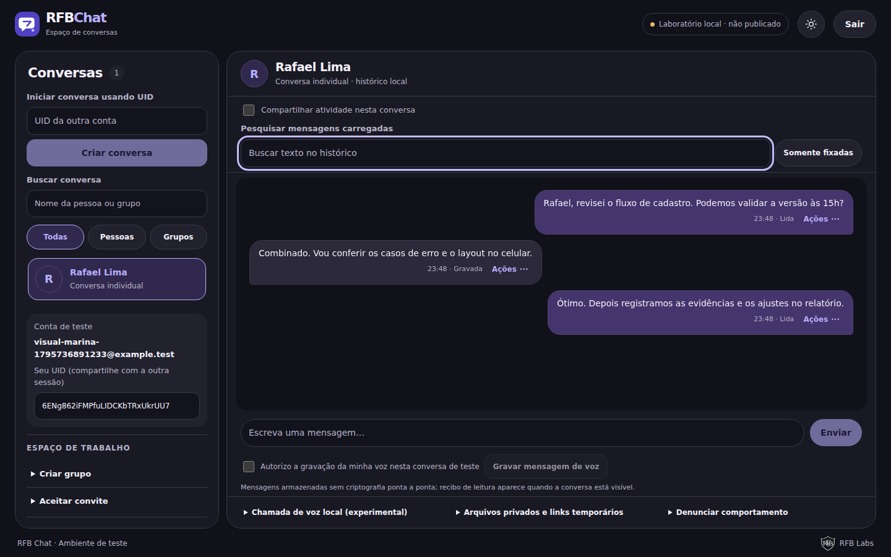
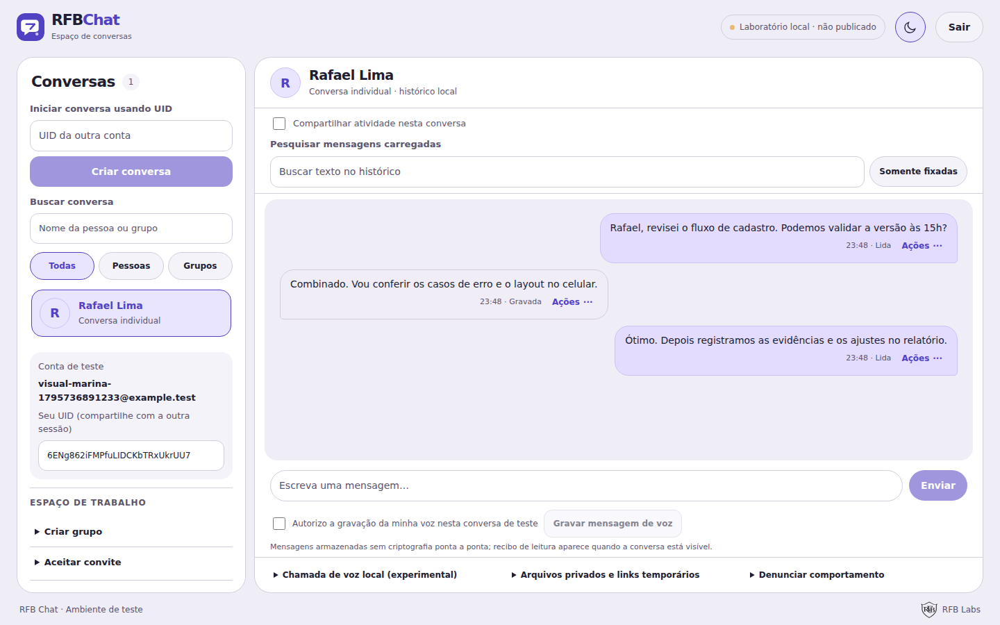
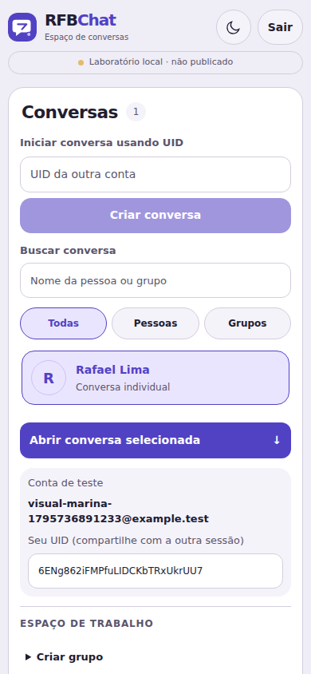
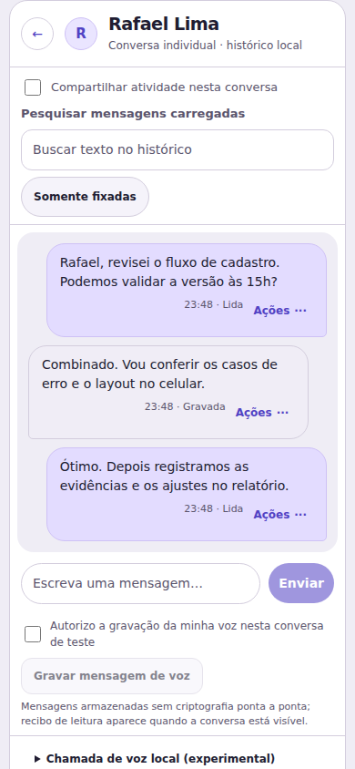

# RFB Chat — RFB Labs

<!-- RFB-PORTFOLIO-README-V1 -->
<div align="center">
  
  
  **Conversas que acompanham sua equipe**
  
  <sub>Laboratório local com Firebase Emulator; sem produção</sub>
</div>

> **Portfólio RFB Labs.** Este projeto valoriza arquitetura, fluxos e evidência técnica real. A identidade SVG V1 aguarda aceite formal e os recursos a seguir têm o estágio detalhado na documentação. Não confundir sandbox/emulador com produção.

**Estado:** laboratório funcional em Firebase Auth/Firestore Emulator, com validação automatizada; **não publicado, não homologado para uso real**. Especificação original: `docs/ESPECIFICACAO-RFB.txt`. RFB Method e inventário de aceites em `docs/rfb/COVERAGE.md`.

## Funcionalidades do laboratório
Login e recuperação de perfil local; conversas privadas e grupos; convites aceitos e cargos; canais de grupo; mensagens em tempo real; respostas, edição, reações, paginação e filtro de conversas; confirmação de entrega/leitura; notificações internas e privacidade; bloqueio e denúncias; moderação com custom claims; áudio WebM consentido até 60s/200KB; arquivos privados até 300KB com galeria de novos uploads com link até 23h e exclusão/revogação manual pelo autor; chamada de voz P2P **experimental** sem TURN/SFU.

**Atenção:** armazenamento inline e WebRTC local são limitados. Não existe criptografia ponta a ponta, hospedagem de mídia escalável, push, SLA, proteção completa antiabuso, backups ou deploy. A expiração do link NÃO elimina os bytes automaticamente do Firestore; o autor pode excluí-los manualmente. A UI de moderação exige custom claims atribuídas em ambiente de confiança — não há concessão de privilégio no cliente. Nunca usar com conversas privadas reais.

## Instalação local
Requer Node 22, npm, Java 21, portas 8080 e 9099 livres. O lockfile está versionado; usar sempre `npm ci`.

```sh
npm ci
npm run emulators
# Em outro terminal:
npm run dev
```

Abra o endereço Vite informado e cadastre contas **sintéticas** em navegadores ou sessões independentes. O Firebase usa `demo-rfb-chat`, não um projeto real. O histórico do emulador pode desaparecer após encerrá-lo.

## QA
```sh
npm run typecheck
npm run test
npm run test:rules
npm run build
npm run test:e2e
```

A suíte Playwright utiliza Chromium com microfone sintético em CI e **sem retries**. Testes de Rules exigem o Firestore Emulator disponível conforme o script `test:rules`. O checkpoint histórico de 23/11 passou com **9 testes unitários, 20 regras Firestore e 10 fluxos E2E sem retries**: https://github.com/CristianoRFB/RFB-Chat/actions/runs/45302857809. Inclui revogação de arquivo por autor, bloqueio ampliado e viewport de 320 a 1440px. A correção da concorrência de cadastro passou em três execuções sucessivas (run 45097362021); a Issue #2 está fechada. Ver `docs/rfb/STATE.json`. O build de produção exibe uma tela de bloqueio intencional.

## Controle e continuidade
- [Escopo original e aceites](docs/ESPECIFICACAO-RFB.txt)
- [Cobertura por AC e gates](docs/rfb/COVERAGE.md)
- [Estado canônico](docs/rfb/STATE.json)
- [Progresso e handoff](docs/rfb/PROGRESS.md)
- [Gates de produção e segurança](docs/rfb/RELEASE-GATES.md)
- [QA atualizado](docs/rfb/QA-2026-11-23.md)
- [Segurança de moderação](docs/ADMIN-MODERATION.md)
- [Benchmark UX](docs/BENCHMARK-UX-2026.md)
- [PR #1 Draft](https://github.com/CristianoRFB/RFB-Chat/pull/1)

**Meta de custo recorrente adicional: R$0**, sujeita a cotas. Nenhum Firebase real, Cloudflare de produção ou plano pago foi criado nesta rodada. Um PR aberto não significa que a branch main contém essas alterações.

## Galeria visual do produto

Capturas reais do laboratório: SHA b2ad72c, [QA visual](https://github.com/CristianoRFB/RFB-Chat/actions/runs/45912988546) PASS, contas sintéticas e mensagens efetivamente trocadas.

### Desktop — escuro e claro



### Mobile
<div align="center"> </div>

[Login](docs/screenshots/evolve-04/01-login-dark-1440.png) · [Tablet](docs/screenshots/evolve-04/06-tablet-light-768.png) · [Manifesto](docs/screenshots/manifest.json) · [Mapa de telas](docs/rfb/SCREEN-MAP.md). Admin/grupos específicos pendentes.

---

<div align="center">
  
  
  <sub>Desenvolvido por RFB · assinatura do criador, independente da marca do aplicativo.</sub>
</div>


## EVOLVE 01 — Complete Messaging (26/11/2026)

Estado: **IMPLEMENTED_PARTIAL / CI_PENDING / PUSH_BLOCKED**. PR #1 Draft; Firebase Emulator; produção não autorizada.

| Slice | SHA do código | Evidência |
|---|---|---|
| S014 — pesquisa e ações | 69f52b1b5c505c798d5d6304fcca35b2dc89a621 | [CI 45760445468](https://github.com/CristianoRFB/RFB-Chat/actions/runs/45760445468): instalação, TypeScript, unitários, build e Rules PASS; E2E em execução na consulta |
| S015 — presença, rede e canais | 6d27b77f15ace44a0747a0518eb193fefd98cb55 | [CI 45760551993](https://github.com/CristianoRFB/RFB-Chat/actions/runs/45760551993): instalação, TypeScript, unitários, build e Rules PASS; E2E ainda não confirmado |
| S016 — hardening, lista de membros e testes | 727782ce3de7c6c31393311b5e38d135b4a46f12 | [CI 45760633858](https://github.com/CristianoRFB/RFB-Chat/actions/runs/45760633858): em execução na consulta; não herda PASS de SHA anterior |

- Busca local sem acentos no texto autorizado, janela inicial 50, expansível em blocos de 50 até 500. Não é indexação integral do banco.
- Exclusão lógica de texto pelo autor substitui corpo por marcador, não permite restauração; reações/respostas novas negadas. Não é garantia de purga de backups/caches nem revogação de cópias encaminhadas; áudio/arquivos permanecem no escopo EVOLVE 02.
- Fixação em DM por membros e em grupos por admin; filtro de fixadas na janela. Encaminhamento de texto como nova mensagem do remetente atual, sem metadados privados de origem.
- Presença voluntária por conversa, desativada inicialmente; atividade aproximada com heartbeat 60s e expiração visual 90s, digitação até 12s. Sem precisão de conexão global, sem TTL físico e sem compartilhamento de conteúdo do rascunho. Leitura/escrita negadas entre DMs bloqueadas.
- Estado de cache/conexão, fila de escrita Firebase em memória enquanto a sessão permanece aberta, confirmação após reconexão. Não habilita cache persistente contendo conversas em dispositivo compartilhado. Recuperação offline após fechar/recarregar não homologada.
- Canais: editar nome/descrição por admin. Grupos: listar participantes e cargos. Notificações internas não contam textos excluídos.
- Push em segundo plano **BLOCKED**: [Issue #3](https://github.com/CristianoRFB/RFB-Chat/issues/3); FCM exige projeto autorizado, service worker, VAPID, permissão e emissor confiável. Agendar no EVOLVE 05/07.
- QA: +1 teste unitário, +5 casos Rules e +2 cenários Playwright adicionados; quantidade aprovada no SHA final depende da execução. Sem QA manual/prints nesta rodada.

Referências oficiais consultadas: https://firebase.google.com/docs/firestore/manage-data/enable-offline ; https://firebase.google.com/docs/firestore/solutions/presence ; https://firebase.google.com/docs/cloud-messaging/web/get-started .
Rollback: reverter os três commits de código na branch de trabalho, em ordem inversa, somente se necessário após diagnóstico; não forçar reset da main. Nenhum custo, merge ou deploy ativado.


## EVOLVE 02 — Media Engine — 26/11/2026

EVOLVE 01: CI do HEAD 1974f77 integralmente verde ([run 45760719067](https://github.com/CristianoRFB/RFB-Chat/actions/runs/45760719067)); nenhuma regressão detectada na suíte; push #3 e persistência offline após fechar permanecem pendentes.

| Slice | SHA | CI |
|---|---|---|
| S017 — anexos e galeria | a9f1afb32b4e1d5c7bb46332b81f0a5df14e1a30 | [45762573543](https://github.com/CristianoRFB/RFB-Chat/actions/runs/45762573543) |
| S018 — voz, RTP, purga local | 359f49011311766ea7b320ae7aaddfec14314093 | [45762642054](https://github.com/CristianoRFB/RFB-Chat/actions/runs/45762642054) |
| S019 — revogação e regressões | 0b66538174cb725083dd4d25b36a7c71ab8ed306 | [CI final](https://github.com/CristianoRFB/RFB-Chat/actions/runs/45762723200): IN_PROGRESS; TypeScript: success; Unit tests: success; Build sem conexões de produção: success; Firestore Rules isoladas (demo-rfb-chat): in_progress; Two users and mobile E2E in isolated emulators: pending |

- Anexos TXT/PDF/PNG/JPEG/WebM/MP4 até 300000 bytes; compressão local de imagens maiores com proporção preservada, entrada máxima 12 MB e 40 MP. Não comprime vídeos grandes nem converte codecs; MP4 depende do suporte do navegador. Prévia de imagem/vídeo ao abrir arquivo. Galeria até 50 metadados, sem baixar bytes em lote; registros antigos sem índice continuam acessíveis por link, não aparecem na galeria.
- Índice e conteúdo gravados/revogados atomicamente para novos uploads; membro autenticado, link ~23h, leitura de bytes negada após expiração, revalidação ao abrir e listener para revogação da prévia. Metadados expirados podem permanecer no banco até purga; não revoga cópias baixadas.
- Áudio WebM até 60 segundos e 200 KB, consentimento, prévia, envio explícito ou direto, cancelamento; sem retenção automática de áudios de conversa. Não há transcrição nem gravação de chamadas.
- Chamadas P2P locais: mute, contador de pacotes RTP inbound; E2E exige recepção em ambas as pontas com microfone sintético. Não comprova áudio humano nem redes externas. Sem STUN/TURN/SFU, não prometer conectividade externa.
- Purga manual `npm run media:purge:local`: somente endpoint fixo loopback 127.0.0.1:8080 e projeto demo-rfb-chat; até 100 anexos expirados por execução; remove bytes e metadados; teste de integração sem dados reais. Não há agendamento em produção.
- Segurança: restrições MIME/volume e ownership, negativos de acesso e índice órfão, revogação, duração. QA manual e auditoria independente ainda pendentes.
- Gate externo [#4](https://github.com/CristianoRFB/RFB-Chat/issues/4): armazenamento escalável privado, política de retenção automatizada e mídia em redes diferentes. Firestore 1 MiB por documento, TTL gerenciado exige billing; R2 tem franquia e excedentes. Não ativar nada sem autorização. Fontes: https://firebase.google.com/docs/firestore/quotas ; https://firebase.google.com/docs/firestore/pricing ; https://developers.cloudflare.com/r2/pricing/ ; https://developer.mozilla.org/en-US/docs/Web/API/RTCInboundRtpStreamStats .
- Nenhum deploy, merge ou custo adicional ativado. Rollback: reverter S019, S018, S017 em ordem inversa na branch de trabalho após diagnóstico; preservar main e considerar compatibilidade dos novos registros antes de reverter regras.

Status: IMPLEMENTED_PARTIAL / IN_PROGRESS / EXTERNAL_GATES_OPEN. Não declarar EVOLVE 02 integralmente encerrado.


## EVOLVE 03 — Administration & Security (26/11/2026)

**Estado atual:** LOCAL_E2E_PENDING_EXTERNAL_GATES_OPEN. PR #1 Draft, emuladores; nenhum recurso de produção, faturamento, merge ou deploy. EVOLVE 02 revalidado no HEAD 957c93b: [CI 45762924505](https://github.com/CristianoRFB/RFB-Chat/actions/runs/45762924505), 11 unitários + 28 Rules + 13 E2E PASS (52 testes). Issues #3 e #4 continuam abertas para gates externos.

| Slice | Entrega | SHA / evidência |
|---|---|---|
| S020 | administração, RBAC delegado, suspensão, banimento, histórico imutável de alterações | [e8dc077](https://github.com/CristianoRFB/RFB-Chat/commit/e8dc077d52b5fd611f5b2d95d1443e061d0ac8a5) / [45911111067](https://github.com/CristianoRFB/RFB-Chat/actions/runs/45911111067) |
| S021 | auditoria de denúncias, cooldown, fila de privacidade e exportação limitada | [e32f78f](https://github.com/CristianoRFB/RFB-Chat/commit/e32f78f5940ea2c978abd5a7c8c5883b4ce27018) / [45911184443](https://github.com/CristianoRFB/RFB-Chat/actions/runs/45911184443) |
| S022 | conflito de interesse, provisionamento local, E2E administrativo, audit de dependências | [f0a5ab9](https://github.com/CristianoRFB/RFB-Chat/commit/f0a5ab9aa305b1b14505cd18748045f937a6c934) / [45911258964](https://github.com/CristianoRFB/RFB-Chat/actions/runs/45911258964) |
| S023 | lockfile resolvido no runner; Firebase Tools 15.37.0, Vitest 5.1.2, overrides tar/grpc-js | [afa75e6](https://github.com/CristianoRFB/RFB-Chat/commit/afa75e67a9c26e860233c488b5929182de537e2e) / [audit candidato](https://github.com/CristianoRFB/RFB-Chat/actions/runs/45911379524) / [CI lockfile](https://github.com/CristianoRFB/RFB-Chat/actions/runs/45911480690) |
| S024 | correção de cadastro; manter formulário montado até término da gravação de perfil, leitura server-side | [a0d544a](https://github.com/CristianoRFB/RFB-Chat/commit/a0d544a0104ed19c8b3b2a51aea7af8ccc10ed27) / [CI final](https://github.com/CristianoRFB/RFB-Chat/actions/runs/45911585835) |

### Funcionalidades e limites
- Admin principal por custom claim confiável; comando local `npm run admin:local -- UID grant --confirm-local` (ou revoke), endpoint fixo do Auth Emulator em loopback. Sem promoção a admin pelo cliente; sair/entrar após alterar claim. Admin ativo pode delegar/revogar moderador via accountControls, sem autoalteração, com justificativa e evento imutável atômico. Até 50 perfis e 50 eventos por consulta; não é diretório global paginado.
- Suspensão: conserva leitura de histórico, impede novas escritas de mensageria; banimento: regras negam acesso às conversas e UI preserva contestação/direitos. Sem expulsão de tokens Auth, sem revogação de cópias/cache anteriores. Chamada ativa deixa UI local ao suspender/banir; testar sessões e sinalização em produção.
- Moderação: estados válidos e registro de operador/horário, histórico não editável, prevenção de decisão sobre denúncia própria ou contra si. Admin/moderador não ganha acesso ao conteúdo das conversas alheias. Denúncia requer gravação atômica com marcador de 30s por conta, validado pelas Rules. Mensagens compostas só de espaços são negadas. Rate limit global de mensagens, convites, upload, cadastro e chamadas continua aberto; não alegar proteção integral.
- Privacidade: exportação JSON de perfil e preferências, acompanhamento de denúncias próprias, solicitação de acesso integral, eliminação e contestação (uma por categoria no laboratório), fila admin e início de análise auditado. Não há exclusão automática nem confirmação fictícia de cumprimento; fluxo operador, identidade, prazos, bases legais, backups, portabilidade, retenção e resposta formal dependem de #5. Preservar acesso à solicitação mesmo quando banido.
- Fontes: https://firebase.google.com/docs/auth/admin/custom-claims ; https://firebase.google.com/docs/emulator-suite/connect_auth ; https://www.gov.br/anpd/pt-br/assuntos/titular-de-dados/direito-dos-titulares ; https://www.planalto.gov.br/ccivil_03/_ato2015-2018/2018/lei/l13709compilado.htm . Não declarar conformidade legal nem revisão independente.

### Auditoria de dependências e regressões
- Baseline S022: 30 alertas, 3 críticos, 11 altos, 16 moderados. A auditoria bloqueou CI conforme gate crítico, sem suprimir saída.
- Candidato read-only gerado via npm no GitHub Actions (sem scripts de instalação nem push automático): 14 moderados, 0 altos, 0 críticos. Aplicado o lockfile real em S023; versão tar 7.5.24 e @grpc/grpc-js 1.14.7; npm ci, typecheck, unit, build, Rules e audit passaram no run 45911480690. Workflow temporário removido; gate permanente `npm audit --audit-level=critical` mantido. Alertas moderados transitivos do toolchain estão na [Issue #6](https://github.com/CristianoRFB/RFB-Chat/issues/6); sem downgrade forçado.
- S020/S021/S022 apresentaram falhas E2E de cadastro (locator #own-uid), antes das operações administrativas. Capturas e contextos reais do [artefato 15160032737](https://github.com/CristianoRFB/RFB-Chat/actions/runs/45911111067) mostraram a tela "Concluir perfil local" com nome genérico. Hipótese: concorrência entre Auth e confirmação do perfil ao montar Workspace após AccountGate. S024 conserva Login montado até a escrita terminar, usa getDocFromServer e consulta auth.currentUser para recuperação. Não aumentou timeout, não adicionou retries nem enfraqueceu Rules.
- **CI da correção S024:** TypeScript: success; Unit tests: success; Build sem conexões de produção: success; Firestore Rules isoladas (demo-rfb-chat): success; Two users and mobile E2E in isolated emulators: in_progress; audit: success. Resultado integral: não homologado até verificação completa.
- QA visual: screenshot de falha realmente inspecionado; sem auditoria visual integral, leitor de tela ou dispositivo físico. G4/G5 produção bloqueados.

### Próximos gates
[#3 push](https://github.com/CristianoRFB/RFB-Chat/issues/3), [#4 mídia externa](https://github.com/CristianoRFB/RFB-Chat/issues/4), [#5 LGPD/antiabuso/governança](https://github.com/CristianoRFB/RFB-Chat/issues/5), [#6 alertas moderados](https://github.com/CristianoRFB/RFB-Chat/issues/6). Antes do EVOLVE 04, confirmar CI da correção e corrigir regressões comprovadas. Rollback: reverter em ordem inversa apenas commits causadores na branch de trabalho; não reverter Rules sem plano de migração para accountControls/reportRate/privacidade e eventos. Não alterar main. Protocolos aplicados: governança GitHub, checkpoint, AntiVibeCoding, AntiLoop (evidência de logs e screenshot; hipótese diferente), QA automatizado, custo R$0 e segurança por Rules. Anti-AI Slop visual integral fica no EVOLVE 04.


# EVOLVE 04 — Visual Excellence — 26/11/2026

**VISUAL_PASS_FULL_CI_PENDING**. Emuladores; PR #1 Draft, sem merge/deploy/billing. 

- EVOLVE 03: [CI anterior](https://github.com/CristianoRFB/RFB-Chat/actions/runs/45911757898) 13/14 E2E; trace 15160327144 parou em getByLabel('Conta', exact:true), embora select estivesse no DOM. S025 labels htmlFor/id explícitos e seleção por valor real. [CI S025](https://github.com/CristianoRFB/RFB-Chat/actions/runs/45912658637) integralmente PASS: 11 unit, 31 Rules, 14 E2E (56), incluindo administração; audit PASS. #5/#6 abertos.
- S025 [954a31b](https://github.com/CristianoRFB/RFB-Chat/commit/954a31b): conversas primeiro, filtros reais, busca sem acentos, temas claro/escuro persistentes, marca SVG própria com 7, assinatura RFB, navegação mobile e estados vazios. Sem imagens decorativas ou controles inertes.
- S026 [09984cd](https://github.com/CristianoRFB/RFB-Chat/commit/09984cd): cenário real de duas contas. [Primeira CI visual](https://github.com/CristianoRFB/RFB-Chat/actions/runs/45912711678) falhou em parser hex abreviado; 3 capturas desktop foram revisadas. Histórico cortava mensagem recente, ações sempre abertas ocupavam espaço, conta abaixo da dobra.
- [420e9eb](https://github.com/CristianoRFB/RFB-Chat/commit/420e9eb): benchmark WhatsApp/Telegram/Slack/Discord/WCAG e mapa de 58 T-IDs; 42 componentes/fluxos mapeados, 16 parciais/consolidados, não são 58 páginas nem percentual global.
- S027 [b2ad72c](https://github.com/CristianoRFB/RFB-Chat/commit/b2ad72c3bffa73f34ae2af0ae5f27ed5437e3d8e): ações/reações em disclosure acessível, ferramentas agrupadas, histórico ampliado, rolagem acompanha mensagens recentes sem forçar leitura antiga, conta reposicionada, parser de contraste corrigido. Testes abriram menu real, sem remover asserts. [QA visual final](https://github.com/CristianoRFB/RFB-Chat/actions/runs/45912988546) PASS (1 cenário, artifact 15160977197), seis PNG reais inspecionados/versionados com SHA256 e Git blob SHA. Desktop e mobile exibem as três mensagens e compositor. Tablet empilhado, não navegação nativa. Dados sintéticos criados pela UI, sem métricas falsas.
- QA: sete larguras 320/360/390/430/768/1024/1440 sem overflow horizontal no cenário, tema claro persistente após reload, busca/filtros, teclado Tab/Enter e pares selecionados de tokens no tema claro ≥4,5:1. Não é auditoria WCAG integral nem validação de todos estados ou tema escuro. Leitor de tela, zoom, dispositivos reais e outros navegadores pendentes.
- [CI final do código](https://github.com/CristianoRFB/RFB-Chat/actions/runs/45912988561): TypeScript: success; Unit tests: success; Build sem conexões de produção: success; Firestore Rules isoladas (demo-rfb-chat): success; Two users and mobile E2E in isolated emulators: in_progress; auditoria success. CI integral não homologada na consulta. Audit gate crítico mantido, 14 moderados #6. Removida impressão de bytes no workflow após captura; futuros runs guardam artefato.
- Protocolos: Anti-AI Slop, Anti-Preguiça, Criatividade, AntiVibeCoding, AntiLoop, QA visual com screenshot anterior, inspeção, correção, recaptura; sem retries. Fontes em docs/BENCHMARK-UX-2026.md. Marca proposta V1 ainda sem aceite formal do proprietário; originais PNG não importados; fotos de admin/grupos/ações abertas faltam. #3 push, #4 mídia externa, #5 LGPD/antiabuso, #6 moderados. Sem produção. Rollback S027/S025 e testes correlatos na branch, preservando correção de labels quando possível. 

[Manifesto](../screenshots/manifest.json) · [Design system](DESIGN-SYSTEM.md) · [Mapa das telas](SCREEN-MAP.md).
